4-Bit Johnson Counter using Master-Slave D Flip-Flops
Design, simulation and layout of a 4-bit Johnson (twisted-ring) counter built from master-slave D flip-flops, which are themselves built from NAND gates and inverters designed at transistor level.
Tool: Cadence Virtuoso 6.1.8 (Schematic Editor, Layout Suite XL, Spectre, ViVA)
Technology: GPDK 90 nm (`gpdk090`)
Library: `counter`
Supply: VDD = 1 V
Transistor sizing (inverter): PMOS W = 120 nm, L = 100 nm; NMOS W = 120 nm, L = 100 nm
---
Table of Contents
Design Hierarchy
Schematics
Symbols
Layouts
Simulation Results
Counting Sequence
Repository Structure
Tools Used
---
Design Hierarchy
```
Jhonson_counter_M_S_D_FF
 └── M_S_D_FF  (master_slave_d_flipflop)  x4
      ├── D-flipflop (d_flipflop)  x2   (master + slave)
      │    ├── NAND gate (nand_transmission)  x4
      │    └── NOT gate (not_gate)  x1
      └── NOT gate (not_gate)  x1   (inverts the clock for the slave)
```
The design is built bottom-up: inverter → NAND gate → D flip-flop → master-slave D flip-flop → Johnson counter.
---
Schematics
1. Inverter (NOT Gate)
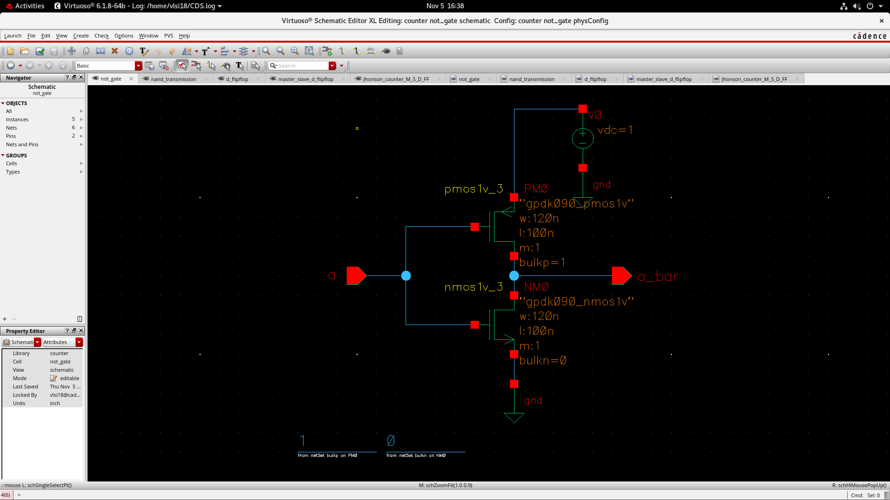
The basic building block of the design. It is a CMOS inverter made of one PMOS (`gpdk090_pmos1v`) and one NMOS (`gpdk090_nmos1v`) transistor, with both gates tied to input `a` and both drains tied to output `a_bar`. The PMOS source/bulk is connected to VDD (1 V) and the NMOS source/bulk to ground. Both transistors use W = 120 nm and L = 100 nm. When `a` is high the NMOS conducts and pulls the output low; when `a` is low the PMOS conducts and pulls the output high.
2. NAND Gate
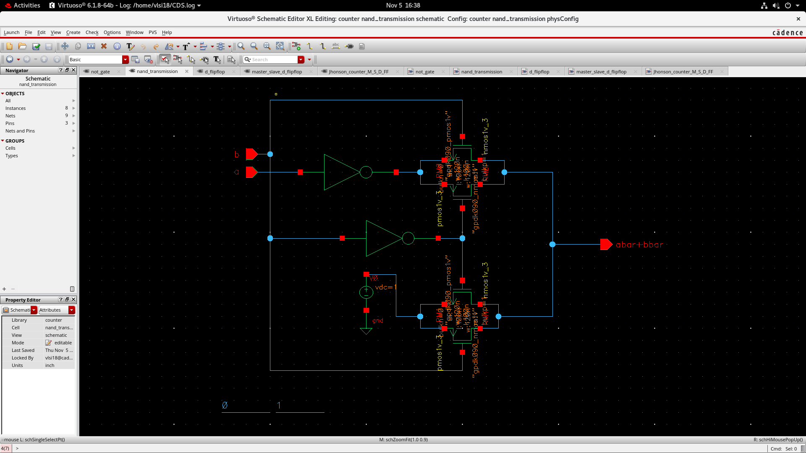
A 2-input NAND gate (inputs `a`, `b`, output `abar+bbar`, i.e. (a·b)′) implemented at transistor level using the same 90 nm devices. Inverters are used on the inputs along with PMOS/NMOS transistor pairs so that the output goes low only when both inputs are high. This NAND gate is the building block of the D flip-flop's latch.
3. D Flip-Flop (D Latch built from NAND gates)
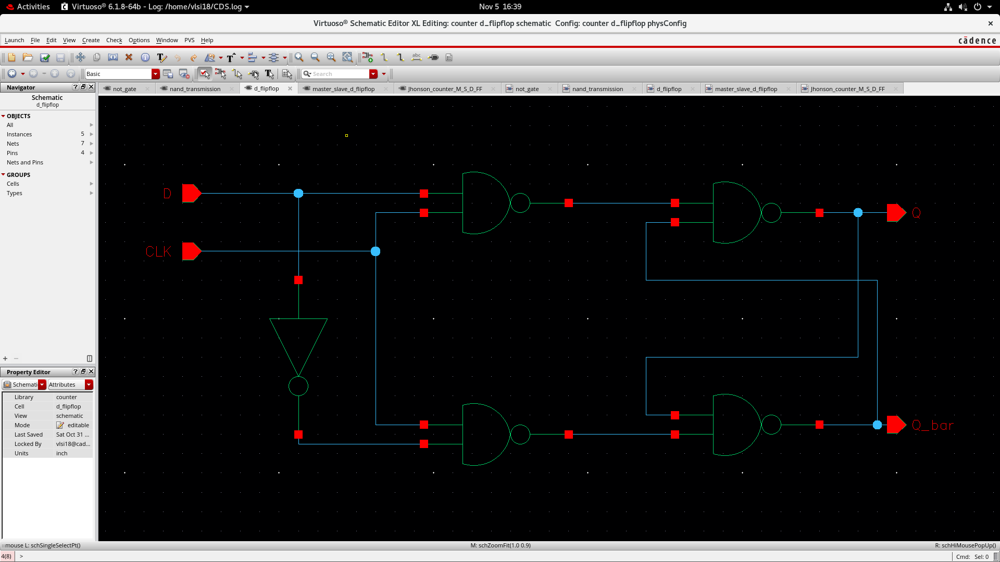
The D storage element is built from four NAND gates and one inverter. The first two NAND gates form the gating stage: one receives `D` and `CLK`, and the other receives `D̄` (from the inverter) and `CLK`. The last two NAND gates are cross-coupled to form an SR latch that produces the outputs `Q` and `Q_bar`. While `CLK` is high, the output follows `D`; when `CLK` goes low, the latch holds its value.
4. Master-Slave D Flip-Flop
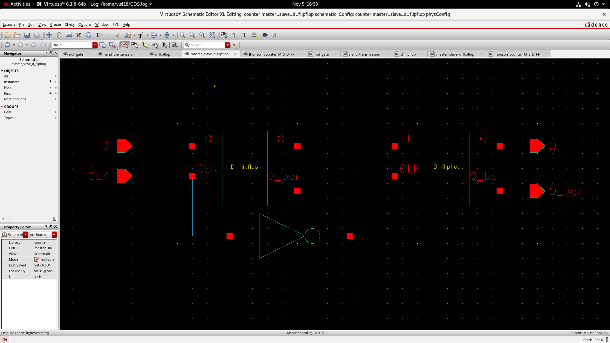
Two D-flipflop stages are cascaded to form an edge-triggered flip-flop. The output of the first stage (master) feeds the `D` input of the second stage (slave). The master receives `CLK` directly, while the slave receives the inverted clock (through an inverter). So the master is transparent while the clock is high and the slave is transparent while the clock is low, which prevents the race-through problem and makes the output change only on the clock's falling edge.
5. Johnson Counter
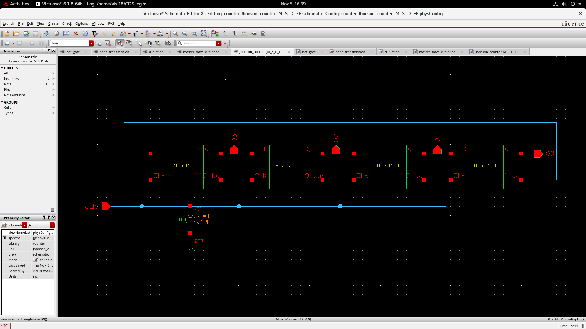
Four master-slave D flip-flops (`M_S_D_FF`) are connected in series and share a common clock. The `Q` output of each flip-flop is connected to the `D` input of the next one, giving outputs `Q3`, `Q2`, `Q1`, `Q0`. The complemented output (`Q_bar`) of the last flip-flop is fed back to the `D` input of the first flip-flop, which is the "twist" that defines a Johnson counter. A pulse source (V0, v1 = 1 V, v2 = 0 V) provides the clock for simulation. An n-bit Johnson counter has 2n states, so this 4-bit counter is a mod-8 counter.
---
Symbols
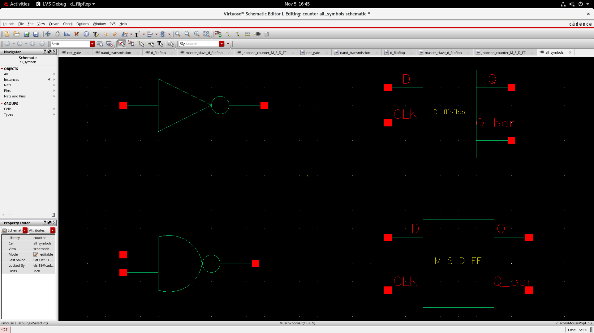
Symbols were created for each sub-circuit so they can be used hierarchically in higher-level schematics: the inverter, the 2-input NAND gate, the D-flipflop (inputs `D`, `CLK`; outputs `Q`, `Q_bar`) and the M_S_D_FF (master-slave D flip-flop with the same pins).
---
Layouts
All layouts were drawn in Virtuoso Layout Suite XL using the `gpdk090` process layers (Nwell, Poly, Pimp/Nimp, Metal1–Metal8, Cont, Vias, etc.).
1. Inverter Layout
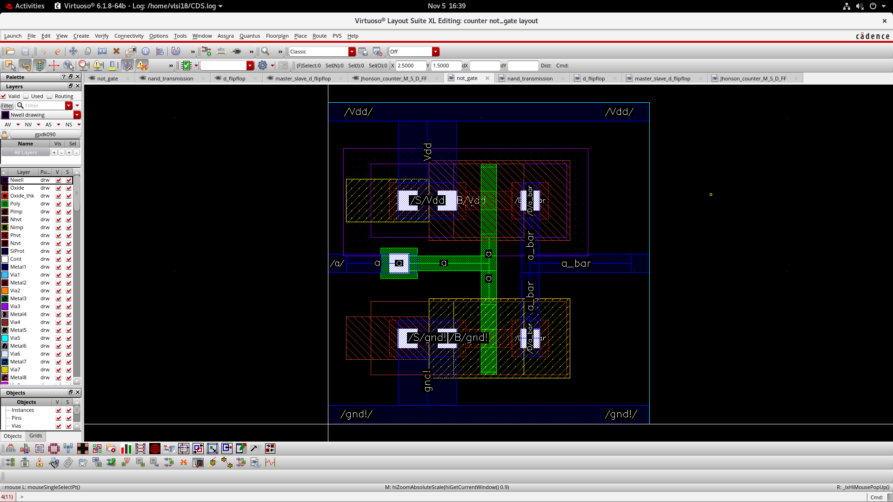
Layout of the CMOS inverter. The PMOS sits in the Nwell at the top, connected to the `/Vdd/` rail, and the NMOS sits at the bottom, connected to the `/gnd!/` rail. A single shared polysilicon gate forms input `a`, and the drains are joined with Metal1 to form `a_bar`.
2. NAND Gate Layout
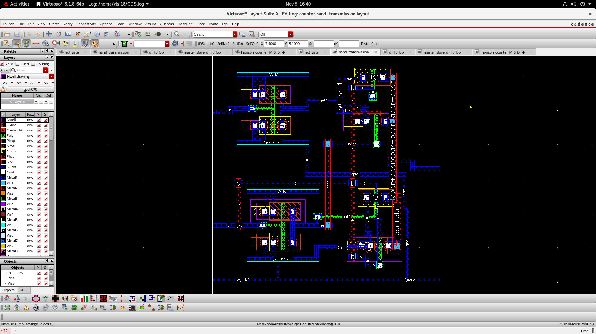
Layout of the NAND gate (`nand_transmission` cell). It contains the input inverters and the PMOS/NMOS transistors, with supply (`/Vdd/`) and ground (`/gnd!/`) rails and internal nets (`net1`, `net3`) routed using Metal1 and higher metal layers. The output is labelled `abar+bbar`.
3. D Flip-Flop Layout
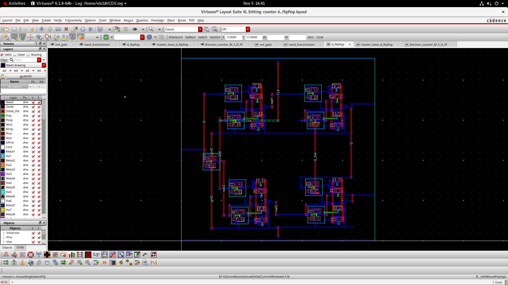
Layout of the D flip-flop. It places four NAND gate instances and one inverter instance, then routes `D`, `CLK`, the internal nets (`net1`, `net2`, `net3`), and the cross-coupled outputs `Q` and `Q_bar` between them, along with a shared `gnd` rail.
4. Johnson Counter Layout
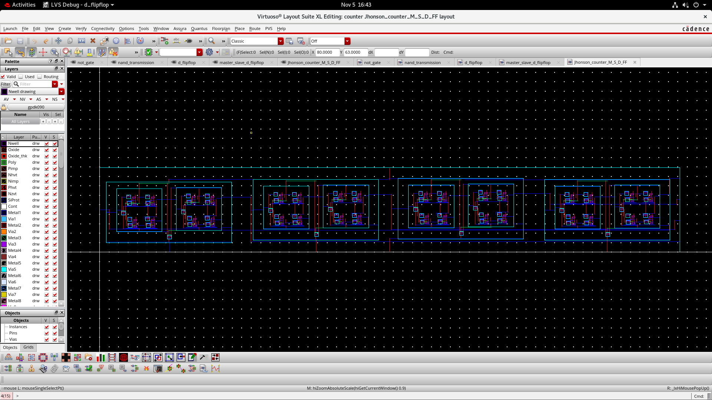
Top-level layout of the Johnson counter. The four master-slave D flip-flop blocks are placed side by side in a row, with the clock distributed to all of them and the `Q` outputs routed to the next stage's input. The `Q_bar` of the last stage is routed back to the first stage's `D` input to complete the feedback loop.
---
Simulation Results
Transient Response
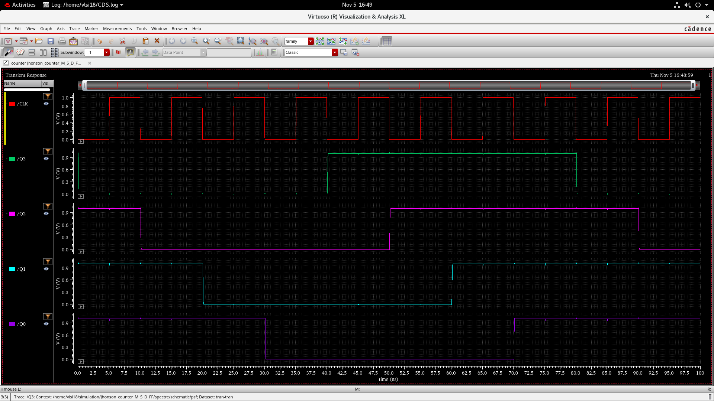
Transient analysis was run for 100 ns with a clock period of 10 ns. The waveforms show `CLK`, `Q3`, `Q2`, `Q1` and `Q0`. The outputs change on the falling edge of the clock, and each output is a delayed copy of the previous stage. After 8 clock cycles (80 ns) the sequence repeats, confirming correct mod-8 Johnson counter operation:
`Q2` falls at 10 ns and rises at 50 ns
`Q1` falls at 20 ns and rises at 60 ns
`Q0` falls at 30 ns and rises at 70 ns
`Q3` rises at 40 ns and falls at 80 ns
---
Counting Sequence
Observed from the transient simulation (`Q3 Q2 Q1 Q0`):
Clock Cycle	Q3	Q2	Q1	Q0
0 (initial)	0	1	1	1
1	0	0	1	1
2	0	0	0	1
3	0	0	0	0
4	1	0	0	0
5	1	1	0	0
6	1	1	1	0
7	1	1	1	1
8	0	1	1	1 (repeats)
---
Repository Structure
```
.
├── README.md
└── images/
    ├── inverter.png
    ├── nand_gate.png
    ├── d_ff.png
    ├── msd_ff.png
    ├── johnson_counter.png
    ├── symbols.png
    ├── inverter_lay.png
    ├── nand_lay.png
    ├── d_ff_lay.png
    ├── johnson_lay.png
    └── transient_outputs.png
```
---
Tools Used
Cadence Virtuoso Schematic Editor XL
Cadence Virtuoso Layout Suite XL
Cadence Spectre (transient simulation)
Virtuoso Visualization & Analysis XL (waveform viewing)
GPDK 90 nm process design kit
---
Author
Your Name — Your College / Department
